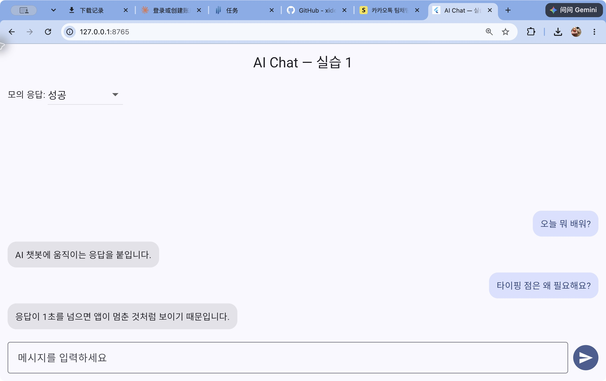
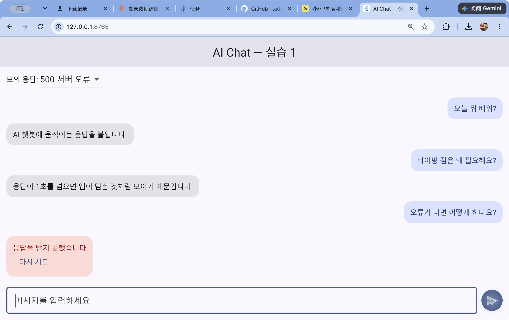
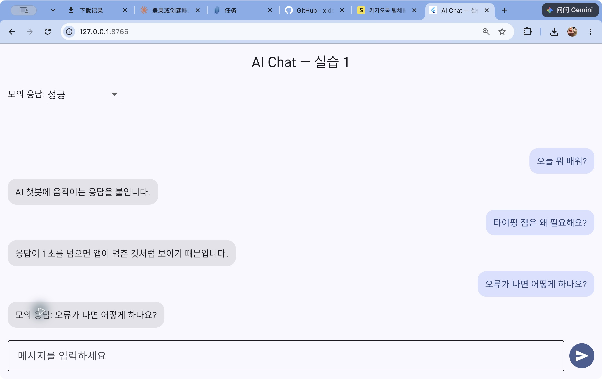

# 실습 1 — 채팅 UI (GAI3008-01 · 11주차)

> 목표: **보내고 받는 모양**을 먼저 만든다. API는 다음 실습에서 붙인다.
> 이 저장소는 **할 일 1번만 완성**되어 있고, 2~5번은 코드 안의 `TODO` 주석으로 안내한다.

## 실행

```bash
flutter pub get
flutter run -d chrome      # 또는 -d <에뮬레이터>
```

서버가 필요 없다. `_messages`에 들어 있는 가짜 대화로 화면만 만든다.

## 할 일

| # | 내용 | 상태 |
|---|---|---|
| 1 | `ListView.builder` + `reverse: true` — 최신이 아래 | ✅ **완성됨** |
| 2 | 말풍선 2종 — 사용자 오른쪽 / AI 왼쪽 | ⬜ `TODO 2` |
| 3 | 입력창 `TextField` + 전송 버튼 | ⬜ `TODO 3` |
| 4 | 빈 상태 — "무엇이든 물어보세요" | ⬜ `TODO 4` |
| 5 | 키보드가 입력창을 가리지 않게 | ⬜ `TODO 5` |

`lib/main.dart`에서 `TODO 2`~`TODO 5`를 검색하면 해당 위치로 바로 간다.

## 완료 기준 (수업 중 통과)

- 말풍선이 **좌우로** 나뉜다
- 입력창이 화면 **아래**에 붙어 있다
- 목록이 비면 **빈 상태 문구**가 보인다
- 키보드가 올라와도 입력창이 **가려지지 않는다**

## 힌트

- `reverse: true`면 index 0이 **화면 맨 아래**다. 그래서 `_messages[length - 1 - i]`로 꺼낸다.
- 색은 `Theme.of(context).colorScheme`에서 꺼내면 다크 모드에서도 안전하다.
- `TextEditingController`는 `dispose()`에서 정리한다.
- `ListView`를 `Stack`으로 감싸면 빈 상태를 위에 겹칠 수 있다.

## 구조

```
lib/main.dart          ← 실습 파일 (TODO 2~5)
test/widget_test.dart  ← 앱이 뜨는지 확인하는 스모크 테스트
```

## 제출

- 이 저장소를 `fork` → 브랜치 `feat/내이름-chat`
- 커밋 2개 이상, PR 1개
- PR 본문 3줄: 무엇 · 왜 · 시험

---

ⓒ 2026 Baryon Labs · 연세대학교 GAI3008-01 응용모바일프로그래밍 교육자료

## 실습 4 — 오류와 재시도

실제 API가 아닌 **모의 응답**으로 성공, 401, 429, 500, timeout을 확인합니다.
상단 선택 메뉴에서 상황을 고르고 메시지를 보내면 됩니다.
시간 초과는 빠른 시연을 위해 1초로 설정했습니다 (강의의 실제 요청 예시는 30초).

- 오류 문구와 `다시 시도` 버튼이 화면에 남습니다.
- `다시 시도`는 마지막 요청을 다시 보내며 사용자 말풍선을 중복 추가하지 않습니다.
- 오류 후에도 입력할 수 있고, 요청 중에는 전송/재시도 중복 실행을 막습니다.
- `AnimatedSwitcher`로 대기/오류/완료 상태를 200ms 동안 전환합니다.
- 429 오류 후 재시도할 때 1초 → 2초 → 4초 → 8초 대기합니다 (최대 8초).
- 복구 확인: 오류가 나온 뒤 모의 응답을 `성공`으로 바꾸고 `다시 시도`를 누릅니다.

검사: `flutter analyze`, `flutter test` (7개 테스트).

### 실행 화면 (실제 Chrome 실행 캡처)

글자와 버튼을 읽기 쉽도록 브라우저를 125%로 확대해 캡처했습니다.
각 이미지를 클릭하면 원본 크기로 볼 수 있습니다. 아래 응답은 실제 AI API가 아닌 모의 응답입니다.

#### 1. 채팅 UI

사용자 메시지는 오른쪽, 응답은 왼쪽에 표시됩니다. 화면 아래에는 입력창과 전송 버튼이 있습니다.

[](docs/chat-ui.png)

#### 2. 500 오류와 재시도 버튼

상단에서 `500 서버 오류`를 선택하고 `오류가 나면 어떻게 하나요?`를 전송했습니다.
오류 안내와 `다시 시도` 버튼이 남아 있어 다시 요청할 수 있습니다.

[](docs/error.png)

#### 3. 재시도 성공

상단을 `성공`으로 바꾸고 `다시 시도`를 눌렀습니다.
오류 안내가 사라지고 마지막 메시지의 모의 응답이 표시됩니다.
같은 사용자 메시지가 두 번 추가되지 않는 것도 확인할 수 있습니다.

[](docs/retry-success.png)
